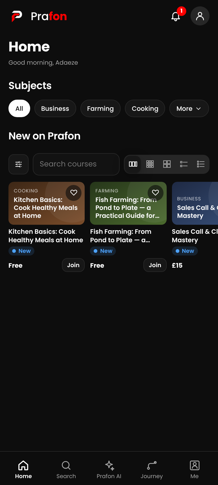
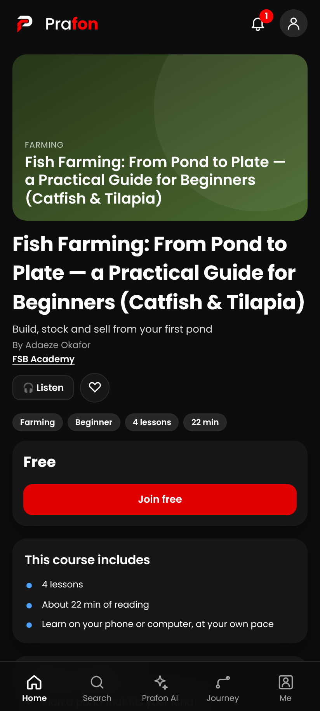
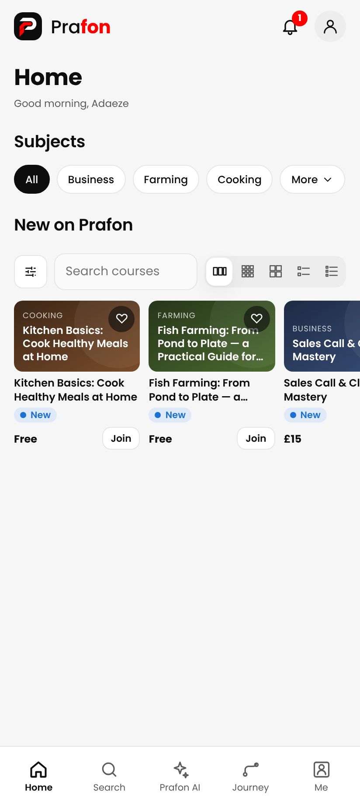
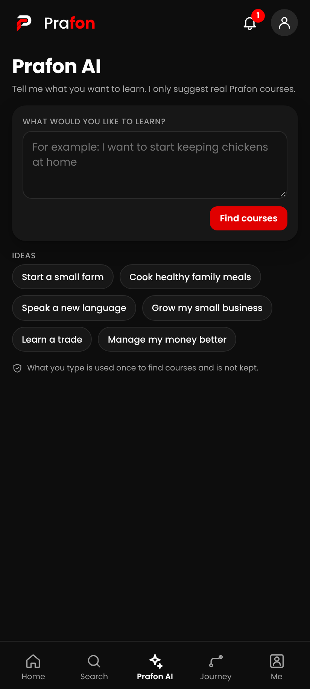
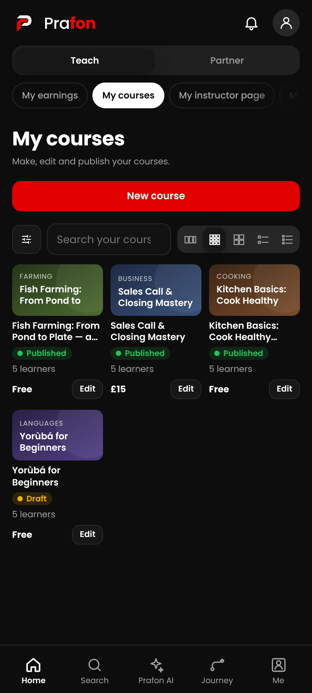
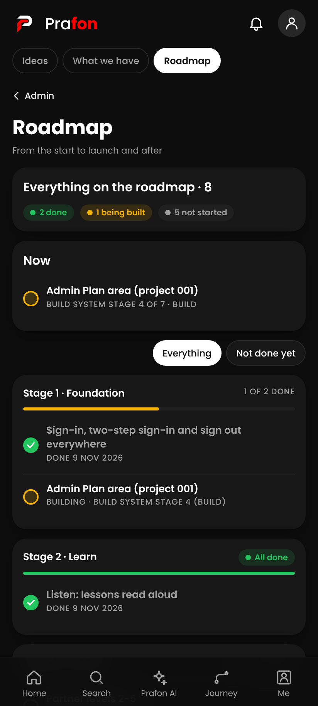
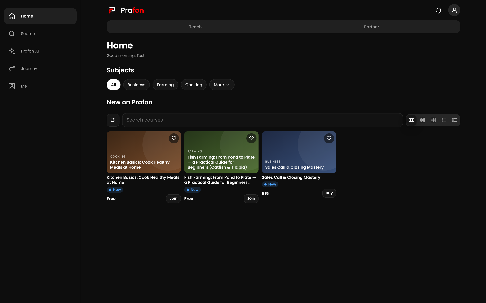

# Prafon

**A learning marketplace where people learn, teach and partner with one account. Phone first, light and dark, built for every subject.**

Live site: [prafon.com](https://prafon.com)

---

## Status (November 2026)

- **Live:** the website, sign-in, browsing and reading courses, the instructor tools and the company admin area.
- **Test mode:** buying courses, gifts and instructor/partner earnings run on Stripe **test** payments. No real money is taken yet.
- **Not switched on yet:** real payments and higher partner levels. Both wait for a legal review.
- **Early stage:** a small number of published courses. No customer, revenue or growth claims.

## Key features

- **Read and learn anywhere.** Courses open on the phone in easy-reading text, or as the original book pages. They open where you stopped, with bookmarks, highlights, notes, search inside the course and "minutes left".
- **Listen.** Any lesson can be read aloud with the phone's own voices, at no cost.
- **Quizzes and certificates.** Short practice questions in lessons, and a certificate with a public check link when a course is finished.
- **Teach.** Instructors import a book (PDF) and get a course split into lessons. They edit it, set a price and publish it. Academies (brands) own their own courses.
- **Find the right course.** Search with subjects, filters and five list views, plus a free AI course finder that has a hard daily limit, so it never costs money.
- **Share and gift.** Partner links, inviting a friend and gifting a course, with a QR code and the phone's share menu.
- **Run it like a company.** Admin is split into departments (support, content, finance, partners, marketing, tech). Each department sees only its own work, and every change is logged.
- **Safe and fair by design.** Two-step sign-in, contact details kept off the platform, "download my data", and accessibility checks on every page.

## How it works

1. A visitor finds a course on the phone, reads the free lessons and joins or buys it.
2. Lessons, progress, notes and certificates are saved to the person's account, so they can continue on any device.
3. Instructors make and sell courses. The platform keeps a share of each sale and records each instructor's share for monthly payouts (test mode today).
4. The company team works in Admin. Each department handles its own requests and reports.

## Tech used

- JavaScript (plain modules, no build step), HTML, CSS
- Cloudflare Workers, Cloudflare R2 (book storage), Cloudflare Workers AI (free tier)
- Supabase (Postgres database, sign-in, row-level security)
- Stripe (test mode)
- Playwright (automated browser checks), Node.js test runner (150+ tests)
- Claude Code (AI coding assistant), with scheduled AI sessions
- GitHub

## What I built and what I learned

**My role:** I designed, directed and shipped Prafon with AI. I own the product: I set the vision, decided every feature and rule, designed how each screen should feel, and tested it on my own phone. The code was written by an AI coding assistant (Claude Code) working under my direction, in small reviewed stages.

**The AI automation behind it:**

- **An AI "autopilot" that builds through a roadmap.** A scheduled AI session wakes every hour. It takes the next item from a written roadmap and works through set stages (brief, design, build, test, launch). It stops at gates that need a human: money, legal wording, accounts and people's data.
- **An automated design and quality checker.** It opens all 75 pages as three kinds of user, in light and dark, at phone, tablet and laptop sizes. It checks layout rules, accessibility (described pictures, named buttons, labelled fields) and a download budget. It compares every page with an approved design and reports changes in plain words, for example "title size 16 -> 15". It also checks itself, by planting faults it must find.
- **Free AI features with hard limits.** The course finder and lesson naming use a free AI tier with a daily ceiling, so they can never run up a bill.

**What I learned:**

- **Write the rules down.** A written rulebook (brand, type scale, wording, privacy, money rules) kept hundreds of AI-made changes consistent.
- **Gates beat speed.** Letting AI move fast only works with automatic checks and clear "ask the human" points.
- **Free first, always profitable.** Every feature is costed before it is built.
- **Honesty with users.** No fake urgency, no income promises, and test mode labelled as test mode.

## Screenshots

_All screenshots use made-up test data; no real people or numbers._

| Home | Course page | Home (light mode) |
|---|---|---|
|  |  |  |

| Prafon AI course finder | Teach: my courses | Admin roadmap |
|---|---|---|
|  |  |  |

**On a laptop:**

